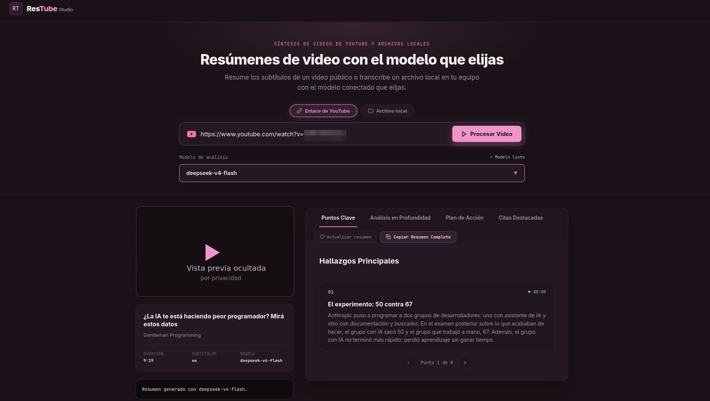

# ResTube — resúmenes de video con Gentle Shell

ResTube resume dos clases de fuente con el modelo conectado que selecciones: **videos públicos de YouTube** (subtítulos accesibles) y **archivos de video locales** (transcripción local con faster-whisper Base). Muestra título, autor, duración e idioma y cuatro secciones de resumen. No hay modelo predeterminado ni contenido de respaldo inventado.

## Vista general



Captura real de la aplicación: fuente de YouTube, modelo elegido del catálogo, puntos clave navegables de a uno y el texto completo con altura natural. La miniatura del video y el identificador del enlace se ocultaron a propósito para no exponer a la persona del video.

## Instalación

```bash
git clone https://github.com/efolchmontiel/ResTube.git
cd ResTube
pnpm install --frozen-lockfile
```

## Uso local

Entorno validado: Linux x64, Node.js 26 y pnpm 12.11.2. Los extractores y el transcriptor se instalan aparte; no se incluyen binarios, modelos ni credenciales en el repositorio.

Requisitos del host: Node.js, pnpm, `uv` en PATH (solo para el setup de transcripción) y `gentle-shell` disponible en PATH con un modelo configurado. Instala dependencias con `pnpm install`; `pnpm-workspace.yaml` autoriza el único script de build que el proyecto necesita (`esbuild`). Sin esa autorización, pnpm 12 aborta la instalación con `ERR_PNPM_IGNORED_BUILDS`.

| Componente | Instalación | Qué deja en `.tools/` |
|---|---|---|
| Extractor de YouTube | `pnpm run setup:yt-dlp` | Binario autónomo `yt-dlp` (versión fijada 2026.10.26, tamaño y SHA-256 verificados) |
| Adaptador de subtítulos | `pnpm run setup:captions` | Python 3.12 gestionado (`captions/python/`) con tubescrape 0.5.0 y httpx 0.28.1 más su árbol exacto de dependencias en versiones fijadas |
| Transcriptor local | `pnpm run setup:transcription` | Python 3.12 gestionado (`python/`), dependencias fijadas y pesos Base (`models/faster-whisper-base`) |

Los instaladores son locales al proyecto: no tocan instalaciones globales, rechazan destinos existentes distintos, no reintentan descargas y nunca marcan salida parcial como éxito. El setup de transcripción descarga los pesos multilingües Base de `Systran/faster-whisper-base` (unos **145 MB de pesos más el entorno de ejecución: el total NO es 145 MB**) en una revisión fijada de Hugging Face; uv solo se usa como herramienta y sus caches quedan dentro de `.tools/`. El modelo **no** se descarga al procesar: si falta, el procesamiento local falla con instrucciones en lugar de iniciar una descarga oculta.

```bash
pnpm run setup:yt-dlp            # instala/verifica .tools/yt-dlp (una vez)
pnpm run setup:captions          # instala/verifica entorno de subtítulos de YouTube (una vez)
pnpm run setup:transcription     # instala/verifica entorno + pesos de transcripción (una vez)
pnpm run dev        # http://127.0.0.1:5173
pnpm test           # pruebas deterministas, sin YouTube, medios ni modelos reales
pnpm run typecheck  # TypeScript
python3 -m unittest discover -s scripts -p 'test_*.py'  # pruebas del wrapper de transcripción
pnpm run build      # genera dist/
pnpm run preview    # sirve dist/ y los bridges locales
```

1. Elige la fuente: **Enlace de YouTube** (`watch?v=`, `youtu.be/`, `shorts/`, `embed/` o `live/` con ID de 11 caracteres) o **Archivo local** (input de video; máximo 128 MiB y 2 horas).
2. Elige un modelo del catálogo conectado y pulsa **Procesar Video** o **Procesar archivo**.
3. Revisa Puntos Clave, Análisis en Profundidad, Plan de Acción y Citas Destacadas. **Copiar Resumen Completo** exporta las cuatro secciones del resultado recibido en Markdown.
4. El resumen muestra el texto completo con altura natural, sin scroll vertical interno ni recortes: para seguir leyendo se desplaza la página normalmente. En escritorios con suficiente altura, el bloque del video acompaña la lectura; en pantallas angostas o bajas permanece en el flujo normal. Los puntos clave se navegan de a uno con **Punto anterior/Punto siguiente** y el indicador «Punto N de Total»; la posición se reinicia con cada resultado nuevo y **Copiar Resumen Completo** sigue exportando todos los puntos, no solo el visible.
5. **Actualizar resumen** vuelve a procesar la fuente anclada (reobtiene subtítulos o re-transcribe el archivo local) con el modelo actualmente seleccionado. No alterna textos predefinidos.

El servidor Vite de desarrollo o preview es necesario: desplegar solo los archivos estáticos no proporciona las APIs. Mantén el servidor en loopback; no lo expongas a una red compartida.

## Fuentes disponibles y límites

| Fuente | Entrada | Transcripción | Privacidad |
|---|---|---|---|
| Enlace de YouTube | URL pública finalizada con subtítulos en español o inglés (manuales o automáticos) | No aplica: se leen subtítulos, no audio | Metadatos y subtítulos van al modelo elegido |
| Archivo local | Video de hasta 128 MiB y 2 horas | faster-whisper Base (CPU int8, multilingüe) en el entorno del proyecto, offline; el audio se decodifica ANTES del motor con PyAV bajo lista blanca | El audio **nunca sale de tu equipo**; del texto transcrito se envía solo lo mismo que en YouTube: metadatos y cues al modelo elegido |

- Se prefieren subtítulos manuales y, dentro de cada grupo, español antes que inglés; después se consideran los automáticos. No hay integración de otras plataformas.
- Un video público puede reproducirse sin cuenta y aun así rechazar la extracción automatizada. Un 403 o una verificación contra bots se informa como `YOUTUBE_BLOCKED`, no como una instrucción de iniciar sesión. Un 401 o rechazo explícito por autenticación se distingue como `YOUTUBE_AUTH`; 429 indica limitación de consultas. Son **errores de extracción**, no fallos del modelo. La app no usa cookies, no evita esas restricciones y no reintenta automáticamente. Prueba otro video público con subtítulos accesibles o espera cuando haya limitación.
- Archivo local: los subtítulos vacíos, el audio sin habla o los medios no decodificables producen un error explícito (`FILE_INVALID`), nunca un resumen inventado. Contenedores admitidos: **solo autocontenidos corrientes** (familia MP4/ISO-BMFF, Matroska/WebM, AVI, Ogg, WAV, MP3, FLAC); las listas de reproducción y formatos de referencia (concat/HLS/DASH/SDP) se rechazan antes de decodificar y jamás siguen referencias. La duración informada es la del medio completo decodificado, incluido el silencio final. La transcripción y el análisis comparten los mismos topes de texto que YouTube; un video que los exceda falla con `TRANSCRIPT_LIMIT` sin recortarse.
- **Solo hay un trabajo activo compartido por ambas fuentes** y una pausa de un segundo entre trabajos. Mientras se procesa una fuente, la otra responde 429. La subida local tiene plazo propio de **120 s**, distinto del plazo total del trabajo (30 min), y contrapresión real: el socket se pausa mientras cada bloque llega a disco.
- El texto se reparte completo y en orden en bloques de hasta 24.000 caracteres JSON serializados (incluye tiempos y escapes), máximo 12 bloques, para YouTube y para la transcripción local por igual. Un fragmento individual grande se divide sin perder texto ni separar pares Unicode. Un bloque usa una llamada directa; varios usan llamadas **secuenciales** para notas y una síntesis final con todas las notas, siempre con el modelo seleccionado. Las notas son resúmenes, no una transcripción sin pérdida: se conserva toda la entrada para procesarla, pero la síntesis comprime el contenido.
- Cada bloque devuelve de 1 a 12 notas de hasta 600 caracteres (el prompt pide 8 de 600) con JSON de hasta 6.000 caracteres y tiempos del bloque; el resumen final pide 8 hallazgos, 3 párrafos y 6 acciones en menos de 7.000 caracteres para no agotar el presupuesto de salida del proveedor, y conserva su esquema estricto con techo de 20 hallazgos. Máximo 26 llamadas con el modelo (12 bloques × 2 intentos + 2 intentos de síntesis), cada entrada de hasta 48.000 caracteres, cada llamada de hasta 120 s y operación total de hasta 900 s. Cada etapa tiene **un** reintento acotado (máximo 2 intentos) cuando la respuesta no cumple el esquema; un fallo del proceso, un timeout o una cancelación no se reintentan. El reintento repite el mismo payload y límites, pero **no** la misma instrucción: el segundo intento añade al final del prompt de sistema un sufijo correctivo acotado construido solo con etiquetas cerradas de reglas locales y escalares seguros (tipo y cantidad de notas, ventana de tiempos del bloque); ante JSON inválido usa un recordatorio constante de formato. El prompt base del primer intento, el stdin y todos los topes siguen intactos, y el sufijo nunca incluye la respuesta cruda del modelo, el texto del video ni texto de excepciones. Esto mejora la probabilidad de corrección pero no es una garantía universal: una respuesta igual de inválida en ambos intentos sigue rechazándose. De la respuesta se lee el primer objeto JSON completo, así un texto posterior del modelo no invalida un resumen correcto; las reglas de campos, límites y cita literal se aplican igual. Existe además una única reparación sintáctica acotada, común a todas las etapas (notas por bloque, resumen corto y síntesis final), aceptada solo por el validador de cada etapa: si el modelo emitió exactamente UNA secuencia contigua ya presente de 2 o 3 tokens de cierre cuyo TIPO no coincide con lo que la pila de anidado exige en esa posición — defecto observado y reproducido en GLM (`]}]` donde el anidado exige `}]}` en la última nota de un video largo) y antes en MiMo (`}]` donde exigía `]}` en la síntesis) —, se reescribe el tipo de esos cierres ya presentes según la secuencia única que demanda la pila, fuera de cadenas y consciente de escapes, sin insertar ni borrar ningún carácter, en el único punto donde el análisis consciente de cadenas muestra la anomalía; el primer objeto JSON debe quedar completo dentro del mismo análisis y pasar la misma validación de esquema estricta de siempre (ventana de tiempos del bloque y topes de notas incluidos) antes de aceptarse. Se conserva la lectura del primer objeto completo: puede haber prosa u otro objeto balanceado alrededor; no se combinan sus datos con el resumen recuperado. Nunca se editan textos, claves ni valores, no hay reparación JSON genérica ni expresiones regulares globales, y cualquier otro defecto de la respuesta (múltiples anomalías estructurales, secuencias de cierre de más de 3 tokens, un cierre aislado, delimitadores faltantes o respuesta truncada, JSON inválido en otro punto, coma, comilla u apertura defectuosa, esquema inválido incluso tras el arreglo sintáctico) sigue rechazándose con `MODEL_RESPONSE` como siempre; las respuestas ya válidas (JSON puro, con vallas o con prosa) se comportan exactamente igual. Un fallo o una cancelación detiene las siguientes llamadas: nunca se publica un resumen parcial. Si no cabe en esos límites, `TRANSCRIPT_LIMIT` informa que no se recortó el contenido.
- El resumen admite hasta 20 hallazgos, 12 párrafos y 20 acciones; un video largo puede alcanzar ese volumen sin recortarse.
- Cuando una etapa devuelve un formato inválido, el servidor registra en consola solo la etapa, el intento y el nombre de la regla incumplida (nunca el texto del video ni del resumen); en fallos de cantidad añade escalares seguros: tipo del campo `notes`, cantidad y largo JSON serializado.
- Una cita solo se muestra como literal si su texto normalizado aparece en los subtítulos. Si no puede comprobarse, se omite. Esto no garantiza la exactitud editorial del resto del resumen: compruébalo con la fuente.

## API local

### `GET /api/models`

Catálogo real mediante `gentle-shell --offline --list-models`, con cache de 30 segundos. La cabecera fija `x-restube-catalog: refresh` fuerza una consulta nueva. Solo expone metadatos públicos; no devuelve configuración ni claves. Se conserva la identidad interna `provider:id`, aunque el selector muestra únicamente nombres.

### `POST /api/summarize`

Exige Host de loopback estricto y Origin obligatorio exactamente igual al esquema/host/puerto del servidor. No acepta query ni fragmentos. `Content-Type: application/json` (opcional `charset=utf-8`), cuerpo UTF-8 de hasta 4 KiB, exclusivamente:

```json
{"url":"https://www.youtube.com/watch?v=abcdefghijk","provider":"proveedor-del-catalogo","model":"id-exacto-del-catalogo"}
```

Antes de extraer se valida la URL y el par exacto del catálogo actual; no se admiten listas de reproducción, credenciales, puertos, URLs arbitrarias ni patrones de modelos. Devuelve:

```text
{ video: { id, url, title, author, duration, language },
  model: { provider, id, name },
  summary: { takeaways: [{ num, time, heading, text }],
    deepdive: { heading, tone, paragraphs, code? },
    actions: { heading, tone, items?, paragraph? },
    quote: null | { text, author, tone } } }
```

`duration` son segundos; `time` es mm:ss o hh:mm:ss; `tone` admite accent/blue/green/yellow. Strings, arrays y campos tienen límites y allowlist en `src/data/summary.ts`, validada tanto en servidor como cliente.

### `POST /api/summarize-local`

Mismas condiciones de red que `POST /api/summarize`: Host de loopback estricto y Origin obligatorio exacto, sin query ni fragmentos, método POST. Subida **binaria cruda** del video (sin multipart ni base64), acotada a **128 MiB** medida al transmitir y a **2 horas** de contenido, con plazo propio de subida de **120 s** y contrapresión real (el socket se pausa hasta que cada bloque llega a disco), con cabeceras fijas:

```text
Content-Type: video/<mime>          (por ejemplo video/mp4)
x-restube-provider: proveedor-del-catalogo
x-restube-model: id-exacto-del-catalogo
x-restube-filename: <encodeURIComponent(nombre.archivo)>
```

El par proveedor:modelo se valida contra el catálogo **antes** de consumir la subida. Los bytes se transmiten a un directorio aleatorio 0700 bajo `.tools/tmp/` con archivo 0600; jamás se acepta una ruta del navegador y el nombre de archivo solo se usa como título visible (sin componentes de ruta). El wrapper de transcripción (`scripts/transcribe.py`, intérprete gestionado del proyecto) **decodifica antes del motor** con PyAV bajo lista blanca estricta de protocolo (`file` único) y de demuxers autocontenidos, escribe el PCM acotado en el mismo job dir y emite un único objeto JSON acotado con duración real del medio (incluido silencio final), idioma y cues con tiempos reales. La respuesta es la misma forma que YouTube con un `video` discriminado:

```text
{ video: { source: "local", id: <hex opaco generado por el servidor>, url: null,
           title: "nombre.archivo", author: "Archivo local", duration, language },
  model: { provider, id, name }, summary: { ...misma forma de cuatro secciones... } }
```

El directorio del trabajo se elimina completo tras el cierre del subproceso, en éxito, fallo o cancelación; no se cachea audio ni transcripción. Errores adicionales saneados: 413 `FILE_LIMIT`/`FILE_DURATION`/`TRANSCRIPT_LIMIT`, 415 `FILE_TYPE`, 422 `FILE_INVALID` (medio inválido o sin habla), 502 `TRANSCRIBER_MISSING` (falta `pnpm run setup:transcription`) y `TRANSCRIPTION`, 400 `LOCAL_REQUEST`.

### Errores comunes

Errores: `{code,error}` con mensaje seguro en español. 400 petición/URL/modelo inválido, 403 origen rechazado, 405 método, 413 tamaño excesivo, 415 tipo de contenido, 429 trabajo ocupado, 422 sin subtítulos/video no disponible, 502 extracción/catálogo/modelo fallido o salida inválida, 504 tiempo agotado. Los códigos `EXTRACTOR_MISSING`, `YOUTUBE_BLOCKED`, `YOUTUBE_AUTH`, `YOUTUBE_RATE_LIMIT`, `YOUTUBE_UNAVAILABLE`, `NO_CAPTIONS` y `MODEL_FAILED` distinguen las causas. No se devuelve stdout/stderr crudo ni se generan resultados cuando falla una etapa. Un `MODEL_RESPONSE` agotado puede adjuntar al mismo campo `error` un contexto curado en español (etapa, bloque y total, motivo cerrado, cantidad segura de notas cuando aplica) construido solo con etiquetas locales y números, nunca con salida del modelo, stderr o texto del video; el cliente solo acepta ese detalle si conserva el prefijo canónico, no supera 400 caracteres y no trae caracteres de control, y en cualquier otro caso muestra el mensaje estático de siempre. Los demás códigos mantienen su mensaje estático invariable.

## Límites de confianza

- `server/summarizeApi.ts`: gates, **ocupación exclusiva única compartida por `/api/summarize` y `/api/summarize-local`**, cuerpos acotados (4 KiB JSON; 128 MiB binarios), cancelación por desconexión y plazos totales de 900 s (YouTube) y 1.800 s (local, subida de hasta 120 s incluida). Una respuesta 504 no libera el cupo antes de que termine el trabajo anterior: mientras se confirma su cierre y la limpieza temporal, otra solicitud recibe 429.
- `server/localVideo.ts`: validación de cabeceras fijas y catálogo antes de consumir la subida; recepción en pausa hasta abrir el destino (sin deadlock nativo), contrapresión por bloque y desmontaje de listeners en toda ruta terminal; parseo estricto del JSON del wrapper (duración ≤ 2 h, cues ≤ 12.000, texto ≤ 240.000 caracteres) y clasificación cerrada de sus códigos de error. El nombre de archivo del navegador solo se usa como título visible: nunca construye una ruta.
- `server/processRunner.ts`: espera el resultado y el evento `close`. En Linux cada comando tiene un grupo aislado; cancelación y timeout terminan el grupo completo, no solo el launcher. Si no se puede confirmar la limpieza, el cupo permanece ocupado para impedir trabajos simultáneos.
- `scripts/setup-ytdlp.mjs`: descarga oficial de versión fijada; tamaño y SHA-256 antes de instalar, 90 s, sin reintentos, sin reemplazar archivos distintos. Reejecutarlo valida la copia existente sin red. Para cambiar la versión se deben actualizar juntos URL, tamaño y hash revisados; un binario existente de otra versión se rechaza, no se elimina automáticamente.
- `scripts/setup-transcription.mjs`: prerequisito `uv` en PATH (no se instala ni modifica globalmente); Python 3.12 gestionado, dependencias de `scripts/transcription-requirements.txt` (faster-whisper 1.2.1, huggingface-hub 2.4.0, **av 15.1.0** — fijada porque faster-whisper 1.2.1 usa `av.open(..., metadata_errors=...)`, keyword eliminado en av 19; sin torch/CUDA) y pesos `Systran/faster-whisper-base` en revisión fijada, verificados con el marcador de revisión. Creación por staging + renombrado: una descarga o instalación parcial nunca queda marcada como éxito; los destinos existentes distintos se rechazan y los caches de uv/HF quedan dentro de `.tools/`.
- `server/youtube.ts`: ejecuta exclusivamente `.tools/yt-dlp` mediante `execFile` sin shell con opciones constantes de yt-dlp, sin configuración/cache/descarga/reintentos; URL watch canónica. Usa `--skip-download --ignore-no-formats-error` para poder obtener metadatos aunque no haya formatos descargables; siguen siendo obligatorios ID, título, autor y duración válidos. Esta opción no elimina bloqueos de acceso de YouTube. El extractor no hereda variables de proxy ni credenciales. La obtención de subtítulos ya no usa la URL `timedtext` de los metadatos: la hace el adaptador `scripts/youtube_captions.py` con el venv fijo `.tools/captions/python` (`-I`, argv `--video-id <id>`, sin shell, sin URLs del llamador). TypeScript revalida su salida estricta `{language,cues}`: claves exactas, idioma es/en, orden no decreciente, tiempos dentro de la duración del video y topes de 12.000 cues y 240.000 caracteres sin recorte.
- `scripts/youtube_captions.py`: único punto de red de subtítulos, con tubescrape 0.5.0 fija y los defaults inseguros de la librería corregidos en la frontera: cero reintentos (`max_retries=0`, `CAPTCHA_MAX_RETRIES=1`; jamás reintenta 403/429/auth y se detiene antes del siguiente pedido), sin cookies, sin proxies (`trust_env=False`), sin redirecciones, solo HTTPS `www.youtube.com` en `/youtubei/v1/player`, `/watch` y `/api/timedtext` con `v=<id>` exacto y sin `tlang`; tope de 4 pedidos y de 8 MiB por respuesta contados en stream. Selección propia de pista: manual antes que automático, español antes que inglés dentro de cada grupo, sin traducción ni respaldo en otros idiomas. Emite el JSON acotado de éxito por stdout y solo tokens `RESTUBE_*` fijos por stderr (runCommand conserva stderr en el rechazo); nunca imprime excepciones, URLs firmadas, claves de API ni texto de transcripción (el logging de la librería está desactivado).
- `scripts/setup-captions.mjs`: prerequisito `uv` en PATH (no se instala ni modifica globalmente); crea `.tools/captions/python` con Python 3.12 gestionado e instala `scripts/captions-requirements.txt` (tubescrape 0.5.0, httpx 0.28.1 y su árbol completo en versiones fijadas, sin pesos ni Whisper). Validación posterior con el intérprete real de las versiones fijadas; staging + renombrado, destinos existentes distintos rechazados y caches de uv dentro de `.tools/`.
- `server/inference.ts`: datos extraídos por stdin, no interpolados en comandos (YouTube y local por igual). Gentle Shell usa `--offline --print --no-session --no-tools --no-mcp --no-skills --no-context-files --no-prompt-templates --no-extensions` y un system prompt fijo que trata metadatos/subtítulos como datos no confiables. Plazo por llamada de inferencia 120 s, salida máxima 256 KiB; sin sesiones persistidas. `server/transcriptChunks.ts` comprueba el plan completo antes de llamar al modelo; `server/inference.ts` valida las notas intermedias y comprueba la cancelación entre bloques y antes de sintetizar. La recuperación compartida de notas, resumen y síntesis solo puede corregir una secuencia contigua ya existente de 2 o 3 cierres cuyo tipo no coincide con el anidado; no agrega ni borra caracteres ni modifica datos, y debe superar el validador de la etapa. El parser estricto exportado no cambia; cualquier otro defecto se rechaza. Se usan las credenciales ya configuradas del host sin enviarlas al navegador.
- `scripts/transcribe.py`: decodifica el medio **antes del motor** con PyAV y `protocol_whitelist='file'` más `format_whitelist` de contenedores autocontenidos (concat/HLS/DASH/SDP rechazados al abrir, sin leer referencias); la duración de metadatos se rechaza antes de decodificar y el conteo real de muestras (16 kHz mono) se aplica mientras itera, así un metadato deshonesto o un medio que supere 2 h es rechazado, jamás recortado. El PCM float32 intermedio se escribe acotado en un temporal propio dentro del job dir (presupuesto pico explícito: 460.800.000 bytes (aproximadamente 439,5 MiB) en disco para 2 h, RSS acotada) y se elimina en éxito o fallo; el motor recibe el arreglo decodificado, nunca la ruta del medio. Carga el modelo solo desde `.tools/models/faster-whisper-base` con `HF_HUB_OFFLINE=1` y `local_files_only=True` (CPU int8, 4 hilos); rechaza URLs y archivos ausentes; silencio o medio inválido es error, nunca una transcripción fabricada; los fallos se reportan como un token `RESTUBE_ERROR:<CÓDIGO>` sin contenido de medios ni rutas.
- React renderiza texto, nunca HTML de metadatos/modelo. YouTube usa el embed sin cookies solo con el ID validado; un archivo local se previsualiza con un blob URL del propio archivo (revocado al reemplazarlo o desmontar), jamás una ruta del servidor; la copia escapa texto y no ejecuta código.
- Cambio de fuente/archivo/modelo, recarga del catálogo y desmontaje abortan solicitudes. Cada ejecución tiene identidad propia: una respuesta tardía A→B→A no puede publicar éxito. Cambiar fuente o archivo descarta el resultado; cambiar modelo conserva el resultado anterior hasta actualizar explícitamente. La copia usa ese resultado fijado, no el selector actual.

## Código y pruebas

React 19, TypeScript, Vite, Vitest/Testing Library; CSS plano con tokens de `src/styles/tokens.css`. Los bridges se registran en `vite.config.ts` para dev y preview. Pruebas públicas de middleware/UI inyectan runner, fetch y transcriptor con fixtures sintéticas: no leen el catálogo privado ni hacen extracción, transcripción ni inferencia reales. El wrapper de transcripción tiene sus propias pruebas con motor inyectado (`python3 -m unittest discover -s scripts -p 'test_*.py'`), que no requieren faster-whisper instalado. La prueba real de subida de un archivo de speech y la comprobación visual en navegador son verificaciones separadas de la suite.

La prueba real de acceso al video y la comprobación visual en navegador son verificaciones separadas de la suite. Si YouTube bloquea el acceso, no hay evidencia de resumen exitoso para ese video aunque el runtime del modelo funcione. No se requieren ni se autorizan cookies/OAuth para el flujo implementado.

## Contribuciones y control de cambios

Los issues y PRs de la comunidad son bienvenidos. Cada issue debe tener etiquetas; para que un PR pueda integrarse debe vincular un issue aprobado por `efolchmontiel`. Los PRs sin esa aprobación permanecen abiertos, pero no son elegibles para merge. Solo el propietario puede actualizar `main`.

Consulta [CONTRIBUTING.md](CONTRIBUTING.md) para el flujo y sus etiquetas. No incluyas claves, cookies, transcripciones privadas ni videos locales en issues, PRs o commits.

## Licencia

Todavía no se ha definido una licencia de uso. Que el repositorio sea público no equivale a conceder una licencia de software libre.
